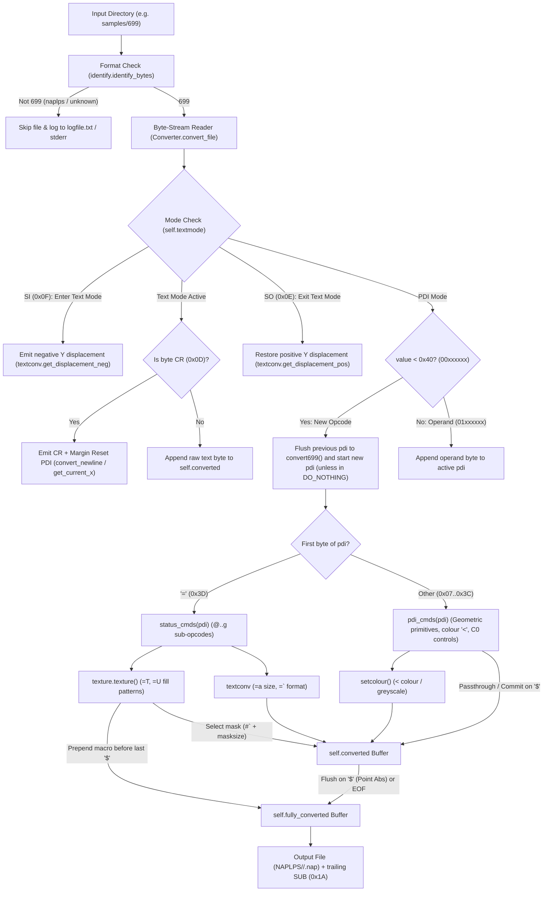

# Architecture: Telidon 699 to NAPLPS Converter

## 1. Overview

**Telidon699toNAPLPS** is a Python 3 binary protocol translator (ported from the original Perl implementation by John Durno, 2019, with no external dependencies beyond the standard library) that converts early **Telidon 699** videotex graphics files (CRC Technical Note No. 699-E, *Picture Description Instructions (PDI) for the Telidon Videotex System*, 1979) into **Telidon 709 / NAPLPS** format (North American Presentation Level Protocol Syntax, ANSI X3.110-1983 / CSA T500-1983).

While Telidon 699 and NAPLPS share the same foundational 7-bit ASCII Picture Description Instruction (PDI) architecture and geometric drawing primitives (`POINT`, `LINE`, `ARC`, `RECTANGLE`, `POLYGON`), NAPLPS reorganized control and status opcodes:
- Telidon 699 multiplexed status commands (screen resets, coordinate domains, colour/greyscale modes, line styles, algorithmic fill patterns, wait timers, and text sizing/formatting) behind a single **`PDI Control – Status` (`=`, `0x3D`)** escape opcode followed by an ASCII sub-opcode (`@` through `g`).
- NAPLPS promoted `DOMAIN` (`!`), `TEXT` (`"`), `TEXTURE` (`#`), `WAIT` (`=`), `SELECT COLOUR` (`>`), `BLINK` (`?`), and `RESET` (`SPC` / `US`) into standalone opcodes, expanded colour specification (`<`), and replaced Telidon 699's algorithmic hatching parameters with predefined and macro-programmable texture masks.

This repository bridges those specification differences so historical Telidon 699 artwork can be rendered on NAPLPS-compliant decoders and emulators.

---

## 2. Repository Structure

```text
Telidon699toNAPLPS/
├── 699toNAPLPS.py       # CLI entry point, byte-stream parser, Converter state machine, and opcode dispatcher
├── textconv.py          # Text size (=a), text format (=` ), and baseline displacement converter (TextState)
├── texture.py           # Fill pattern (=T, =U) to NAPLPS programmable texture mask synthesizer
├── bitutil.py           # Bit-packing and numeric formatting helpers (Perl pack/stringify parity)
├── identify.py          # Telidon 699 vs. NAPLPS format detector (CLI + identify_bytes/identify_file API)
├── batch_convert.sh     # Bash wrapper to batch-convert samples/699/ into samples/naplps/
├── __init__.py          # Package marker
├── ARCHITECTURE.md      # This architecture reference
├── comparison.md        # Opcode-by-opcode reference table comparing Telidon 699 and NAPLPS (0x00–0x7F)
├── comparison.ods       # OpenDocument Spreadsheet version of the 699 vs. NAPLPS opcode table
├── samples/
│   ├── 699/             # Corpus of 73 Telidon 699 test graphics files (primitives, text, fills, RGB)
│   └── naplps/          # Batch-converted NAPLPS (.nap) outputs
├── README.txt           # Usage instructions and known limitations
└── LICENSE              # GNU General Public License v2.0
```

---

## 3. High-Level Data Flow



---

## 4. Core Components & Subsystems

### 4.1 Byte-Stream Parser, Validation & State Machine ([699toNAPLPS.py](file:///Users/nick/GitHub/TEIA_TELIDON_ETC/Telidon699toNAPLPS/699toNAPLPS.py))

`main()` ([699toNAPLPS.py](file:///Users/nick/GitHub/TEIA_TELIDON_ETC/Telidon699toNAPLPS/699toNAPLPS.py#L432-L476)) iterates over all non-hidden entries in `<indir>` via `list_input_files()` ([699toNAPLPS.py](file:///Users/nick/GitHub/TEIA_TELIDON_ETC/Telidon699toNAPLPS/699toNAPLPS.py#L424-L429)), skipping subdirectories and `*text` files. Each candidate file is validated with `identify.identify_bytes()` before conversion; non-699 files (already-NAPLPS, plain text, binary, or empty) are logged to `logfile.txt` and `stderr` and skipped. Valid 699 files are converted by a single `Converter` instance and written to `NAPLPS/<indir>/<filename>.nap`.

#### Instruction Framing
Telidon 699 uses 7-bit ASCII framing where bit 6 distinguishes **opcodes** (`00xxxxxx`, `0x00`–`0x3F`) from **multi-byte operands/data** (`01xxxxxx`, `0x40`–`0x7F`):
1. `Converter.convert_file()` ([699toNAPLPS.py](file:///Users/nick/GitHub/TEIA_TELIDON_ETC/Telidon699toNAPLPS/699toNAPLPS.py#L359-L421)) iterates byte-by-byte over the input `bytes`.
2. In **PDI Graphics Mode (`self.textmode == False`)**, any byte `< 0x40` flushes the previously accumulated `pdi` instruction via `convert699(pdi)`.
3. Unmapped C0 control characters and unused 699 opcodes (`NUL`, `SOH`–`ACK`, `DLE`–`CAN`, `SUB`–`US`, `SPC`, `!`, `"`, `#`, `>`, `?`) are listed in `DO_NOTHING` ([699toNAPLPS.py](file:///Users/nick/GitHub/TEIA_TELIDON_ETC/Telidon699toNAPLPS/699toNAPLPS.py#L27-L36)) and ignored so they do not start a spurious `pdi` accumulation.
4. Operand bytes (`0x40`–`0x7F`) are appended onto `pdi` until the next opcode, mode switch (`SI`), or `EOF`.

#### Two-Stage Output Buffering (`self.fully_converted` vs. `self.converted`)
`Converter` maintains two byte buffers per file ([699toNAPLPS.py](file:///Users/nick/GitHub/TEIA_TELIDON_ETC/Telidon699toNAPLPS/699toNAPLPS.py#L154-L175)):
- **`self.converted`**: Accumulates translated NAPLPS commands starting from the most recent `POINT Set (Absolute Invisible)` (`$`, `0x24`).
- **`self.fully_converted`**: Stores all output committed prior to the most recent `$` command.

Whenever a new `$` (`0x24`) opcode is processed in `pdi_cmds()` ([699toNAPLPS.py](file:///Users/nick/GitHub/TEIA_TELIDON_ETC/Telidon699toNAPLPS/699toNAPLPS.py#L294-L319)), `self.current_position` is updated, the existing `self.converted` buffer is flushed to `self.fully_converted`, and `self.converted` is reset to hold the new `$` instruction. This two-stage buffer enables **retroactive macro injection**: when a custom fill texture (`=T` or `=U`) is encountered *after* a `$` positioning command, the NAPLPS texture definition macro (which moves the drawing cursor to `0,0` to draw the 16×16 texture bitmap) can be appended to `self.fully_converted`—placing it *before* the `$` positioning command in the final byte stream so the drawing cursor position is not clobbered.

#### Session Initialization (`initialize_pdi`)
For the first valid 699 file converted (`converted_count == 1`) and whenever `=B` (Reset/Initialize) is encountered, `initialize_pdi()` ([699toNAPLPS.py](file:///Users/nick/GitHub/TEIA_TELIDON_ETC/Telidon699toNAPLPS/699toNAPLPS.py#L335-L338)) emits a 22-byte NAPLPS bootstrap sequence:
- `SO` (`0x0E`), `CAN` (`0x18` – end macro processing), `US @@` (`0x1F 0x40 0x40` – Non-Selective Reset),
- `SO` (`0x0E`), `=@` (wait 0), `SPC {O` (Selective Reset),
- `!H@@I` (`DOMAIN`: 1-byte single-value operands, 3-byte multi-value 2D coordinates, minimum logical pel size `@@I`),
- `SI` (`0x0F`), `SO` (`0x0E`), `#@@@` (reset line/fill texture).

---

### 4.2 Opcode & Status Command Translation ([699toNAPLPS.py](file:///Users/nick/GitHub/TEIA_TELIDON_ETC/Telidon699toNAPLPS/699toNAPLPS.py))

#### Geometric Primitives & C0 Controls (`pdi_cmds`)
Handled in `Converter.pdi_cmds()` ([699toNAPLPS.py](file:///Users/nick/GitHub/TEIA_TELIDON_ETC/Telidon699toNAPLPS/699toNAPLPS.py#L294-L319)):
- **Passthrough Primitives**: `POINT` (`$`, `%`, `&`, `'`), `LINE` (`(`, `)`, `*`, `+`), `ARC` (`,`, `-`, `.`, `/`), `RECTANGLE` (`0`, `1`, `2`, `3`), and `POLYGON` (`4`, `5`, `6`, `7`) share identical opcode and 9-bit (3-byte) coordinate operand encodings between Telidon 699 and NAPLPS and are copied verbatim.
- **Format Effectors & Shift Codes**: `BEL` (`0x07`), `BS` (`0x08`), `HT` (`0x09`), `LF` (`0x0A`), `VT` (`0x0B`), `FF` (`0x0C`), `CR` (`0x0D`), `SO` (`0x0E`), `SI` (`0x0F`), and `EM` (`0x19` – G2 accents) are passed through, with `SO` additionally restoring text baseline displacement when `self.displacement_flag` is set.
- **Bit Formats (`8`, `9`, `:`, `;`)**: Telidon 699 run-length and point-by-point raster opcodes are detected and logged to stdout as unimplemented.

#### Status Sub-Commands (`status_cmds`)
In Telidon 699, `=` (`0x3D`) prefixes status commands where the second byte (`@` through `g`) selects the operation ([699toNAPLPS.py](file:///Users/nick/GitHub/TEIA_TELIDON_ETC/Telidon699toNAPLPS/699toNAPLPS.py#L185-L227)):

| 699 Status Prefix | 699 Meaning | Converter Action / NAPLPS Output |
| :--- | :--- | :--- |
| `=@` | Clear screen to black | Emits Selective Reset `SPC x DEL` (`0x20 0x78 0x7F`) |
| `=A` | Clear screen to transparent | Logged to `logfile.txt` (unimplemented) |
| `=B` | Clear to black & initialize | Calls `initialize_pdi()` |
| `=C` | Clear screen to current colour | Emits Selective Reset `SPC h DEL` (`0x20 0x68 0x7F`) |
| `=D` .. `=G` | Coordinate domain (9, 12, 15, 18 bits) | Logged (`=D` 9-bit/3-byte is already the default) |
| `=H` | Blink off, transparency off | Emits `?@@@` (`0x3F 0x40 0x40 0x40`) |
| `=I` .. `=K` | Blink / transparency combinations | Logged to `logfile.txt` |
| `=L`, `=N` | Colour mode | Sets `self.colourmode = 1`; re-runs `setcolour(self.current_colour)` |
| `=M`, `=O` | Greyscale mode | Sets `self.colourmode = 0`; re-runs `setcolour(self.current_colour)` |
| `=P` .. `=S` | Line style (solid, dotted, dashed, dot-dash) | Emits `#@`, `#A`, `#B`, or `#C` |
| `=T`, `=U` | Fill pattern (no highlight / colour highlight) | Delegates to `texture.texture()`; emits `#` texture command |
| `=V`, `=W` | Fill black highlight / reserved | Logged to `logfile.txt` |
| `=X` .. `=[` | Marker control | Logged to `logfile.txt` |
| `=\` .. `=_` | Wait commands (timed / indefinite) | Logged to `logfile.txt` |
| `` =` `` | Text format (rotation, spacing, break) | Delegates to `textconv.textformat()`; emits `"` + format + size |
| `=a` | Text size (8 sizes + double-height bit) | Delegates to `textconv.textsize()`; emits `"` + format + size |
| `=b` .. `=g` | Character set, tabs, reserved char defs | Logged to `logfile.txt` |

#### Colour & Greyscale Conversion (`setcolour`)
Telidon 699's `PDI Control – Value` (`<`, `0x3C`) specifies a 3-bit GRB colour or 3-bit greyscale intensity in bits 5..3 (`byte_bits(pdi[1])[2:5]`) of its first operand byte ([699toNAPLPS.py](file:///Users/nick/GitHub/TEIA_TELIDON_ETC/Telidon699toNAPLPS/699toNAPLPS.py#L320-L334)):
- **Colour Mode (`self.colourmode == 1`)**: Because NAPLPS interleaves `G R B G R B` bits across each 6-bit data byte (`01xxxxxx`), a 3-bit 699 primary colour (`G R B`) is converted to full-intensity NAPLPS RGB by repeating the 3-bit group twice per byte (`01` + `GRB` + `GRB`) across 3 operand bytes (`<` + 3 identical bytes).
- **Greyscale Mode (`self.colourmode == 0`)**: In Telidon 699, a 3-bit value `(b1, b2, b3)` represents an 8-level greyscale intensity where `R = G = B = (b1, b2, b3)`. To encode equal `G`, `R`, and `B` channels in NAPLPS's interleaved `G R B G R B` bit layout across 3 bytes (9 bits per channel), each bit of the 3-bit intensity is tripled across the three bytes:
  - Byte 1: `01` + `b1 b1 b1` + `b2 b2 b2`
  - Byte 2: `01` + `b3 b3 b3` + `b1 b1 b1`
  - Byte 3: `01` + `b2 b2 b2` + `b3 b3 b3`

---

### 4.3 Text Conversion & Baseline Compensation ([textconv.py](file:///Users/nick/GitHub/TEIA_TELIDON_ETC/Telidon699toNAPLPS/textconv.py))

`textconv.py` translates Telidon 699's discrete text attributes (`=a` and `` =` ``) into NAPLPS's continuous coordinate-based `TEXT` (`"`, `0x22`) command and compensates for character cell origin differences, storing per-converter text state explicitly in `TextState` ([textconv.py](file:///Users/nick/GitHub/TEIA_TELIDON_ETC/Telidon699toNAPLPS/textconv.py#L39-L44)):

1. **Character Size (`textsize`, [textconv.py](file:///Users/nick/GitHub/TEIA_TELIDON_ETC/Telidon699toNAPLPS/textconv.py#L52-L66))**:
   - Unpacks the operand byte of `=a`: bit 5 is `state.double_height`, and bits 2..0 form a 3-bit size index (`0` = largest to `7` = smallest).
   - Maps the size index to a character-per-line denominator via `XVALUES = (26, 36, 54, 72, 96, 128, 180, 260)` ([textconv.py](file:///Users/nick/GitHub/TEIA_TELIDON_ETC/Telidon699toNAPLPS/textconv.py#L22)), computing normalized width $dx = \frac{1}{\text{XVALUES}[\text{size}]}$ and height $dy = \frac{11}{8} \times dx$ (doubled if `double_height` is set).
   - Encodes $(dx, dy)$ as a 3-byte (9-bit fixed-point binary fraction) NAPLPS coordinate operand via `dec2pdi()` and `dec2bin()` ([textconv.py](file:///Users/nick/GitHub/TEIA_TELIDON_ETC/Telidon699toNAPLPS/textconv.py#L118-L144)).

2. **Text Format (`textformat`, [textconv.py](file:///Users/nick/GitHub/TEIA_TELIDON_ETC/Telidon699toNAPLPS/textconv.py#L69-L79))**:
   - Unpacks the operand byte of `` =` ``: extracts character path rotation (bits 3..2) and vertical line spacing (bits 1..0).
   - Maps 699's vertical spacing (`1, 1.5, 2, 2.5`) to NAPLPS's spacing (`1, 1.25, 1.5, 2`) via `INTERNARROW` ([textconv.py](file:///Users/nick/GitHub/TEIA_TELIDON_ETC/Telidon699toNAPLPS/textconv.py#L30-L35)) and returns the 2-byte NAPLPS `TEXT` format operand.
   - Whenever either `` =` `` or `=a` is processed in `699toNAPLPS.py`, both `self.current_textformat` and `self.current_textsize` are combined into a complete 6-byte NAPLPS `"<format><size>` instruction.

3. **Vertical Baseline Displacement (`get_displacement_neg` / `get_displacement_pos`, [textconv.py](file:///Users/nick/GitHub/TEIA_TELIDON_ETC/Telidon699toNAPLPS/textconv.py#L87-L111))**:
   - Telidon 699 and NAPLPS align the character box differently relative to the graphics cursor upon entering text mode (`SI`).
   - When `SI` (`0x0F`) transitions `self.textmode` from `False` to `True`, `699toNAPLPS.py` emits a `POINT Relative Invisible` (`%`) command generated by `get_displacement_neg()` using empirical per-size offset tables (`DISP` and `DISP_DOUBLE`, [textconv.py](file:///Users/nick/GitHub/TEIA_TELIDON_ETC/Telidon699toNAPLPS/textconv.py#L23-L24)) to shift the baseline down.
   - When `SO` (`0x0E`) exits text mode, `get_displacement_pos()` emits the inverse `%` relative shift so subsequent graphics primitives resume from the expected coordinate.

4. **Carriage Return Left-Margin Alignment (`convert_newline` & `get_current_x`, [699toNAPLPS.py](file:///Users/nick/GitHub/TEIA_TELIDON_ETC/Telidon699toNAPLPS/699toNAPLPS.py#L340-L357))**:
   - In Telidon 699, a `CR` (`0x0D`) in text mode returns the cursor to the X coordinate established by the most recent `POINT Set (Absolute Invisible)` (`$`).
   - `convert_newline()` extracts only the X bits from `self.current_position` (`get_current_x()`, masking Y bits to `000`) and wraps a relative positioning sequence (`SO` + `%<x_coords>` + `SI`) immediately after `CR`.

---

### 4.4 Algorithmic Fill to Programmable Texture Synthesis ([texture.py](file:///Users/nick/GitHub/TEIA_TELIDON_ETC/Telidon699toNAPLPS/texture.py))

In Telidon 699, `=T` (fill without outline highlight) and `=U` (fill with colour highlight) specify hatching patterns algorithmically using coordinate-like operands:
- The first bit of X (`x_angle`) and Y (`y_angle`) selects diagonal hatching (+45° / +135°) vs. orthogonal hatching (0° / 90°).
- The next 4 bits of X and Y specify fractional line densities (`x_dec`, `y_dec` in $\frac{1}{16}$ increments).

`texture.texture(operands)` ([texture.py](file:///Users/nick/GitHub/TEIA_TELIDON_ETC/Telidon699toNAPLPS/texture.py#L22-L96)) converts these algorithmic parameters into `(texture_bytes, masksize)` for NAPLPS `TEXTURE` (`#`, `0x23`) commands:
1. **Solid Fill Shortcut**: If either X or Y density bits are `1111`, or if both `x_fill < 2` and `y_fill < 2` with no angle flags, `texture()` returns `(b'@', None)` (NAPLPS solid fill `#@`).
2. **16×16 Bitmap Synthesis**:
   - Converts fractional densities into integer pixel strides via `_fill_stride()` ([texture.py](file:///Users/nick/GitHub/TEIA_TELIDON_ETC/Telidon699toNAPLPS/texture.py#L99-L105)).
   - Generates a 256-character (`16 × 16`) binary string (`'0'` / `'1'`) using one of three pattern generators:
     - `gridrect(x_fill, y_fill)` ([texture.py](file:///Users/nick/GitHub/TEIA_TELIDON_ETC/Telidon699toNAPLPS/texture.py#L108-L119)): Horizontal (`masksize = b'@B@'`), vertical (`b'@P@'`), or crosshatch grid (`b'@R@'`).
     - `gridangle_y(fill)` ([texture.py](file:///Users/nick/GitHub/TEIA_TELIDON_ETC/Telidon699toNAPLPS/texture.py#L122-L133)): +135° diagonal lines (`b'@R@'`).
     - `gridangle_x(fill)` ([texture.py](file:///Users/nick/GitHub/TEIA_TELIDON_ETC/Telidon699toNAPLPS/texture.py#L136-L148)): -45° diagonal lines (`b'@R@'`).
3. **NAPLPS Macro & Incremental Point Packing (`def_texture_begin` / `def_texture_end`)**:
   - Each 16-bit row of the 16×16 grid is right-padded with two `'0'` bits to 18 bits and packed into three 6-bit NAPLPS data bytes (`01xxxxxx`), yielding $16 \times 3 = 48$ bitmap bytes.
   - `def_texture_begin(pelsize)` ([texture.py](file:///Users/nick/GitHub/TEIA_TELIDON_ETC/Telidon699toNAPLPS/texture.py#L151-L158)) prefixes the bitmap with `@R@!I<pelsize>` + `ESC D A` (define macro `A` as texture mask) + `8$` + `9A` (Incremental Point opcode `9` with operand `A`).
   - `def_texture_end()` ([texture.py](file:///Users/nick/GitHub/TEIA_TELIDON_ETC/Telidon699toNAPLPS/texture.py#L161-L163)) appends `ESC E` (end macro definition) + `SO` + `!H@@I#@` (restore default coordinate domain and solid texture).
4. **Texture Slot Registration (`Converter.register_texture`, [699toNAPLPS.py](file:///Users/nick/GitHub/TEIA_TELIDON_ETC/Telidon699toNAPLPS/699toNAPLPS.py#L259-L292))**:
   - NAPLPS supports four programmable texture masks (`` ` ``, `h`, `p`, `x`), tracked in `self.textures`. Due to decoder compatibility issues noted in comments, `self.texture_slots` is pinned to slot `` ` `` (`0x60`).
   - When a new custom fill pattern is synthesized, `#` + `` ` `` + `tex` is appended to `self.fully_converted` (before the last `$` absolute point), and `#` + `` ` `` + `masksize` is appended to `self.converted` to activate the mask.

---

### 4.5 Format Detection ([identify.py](file:///Users/nick/GitHub/TEIA_TELIDON_ETC/Telidon699toNAPLPS/identify.py))

`identify.py` provides both a standalone CLI (`./identify.py [-v] <file> [...]`) and an importable API (`identify_bytes()`, `identify_file()` returning an `IdentificationResult`) used by `699toNAPLPS.py` to validate inputs before conversion:
1. **7-Bit Guard**: Rejects empty files and files containing non-7-bit bytes (`>= 0x80`) as `unknown`.
2. **Mode-Aware Parsing**: Tracks G0 text mode (`SI` `0x0F`) vs. G1 PDI mode (`SO` `0x0E`) and handles `ESC`, `US`, and `EM` control sequences so printable ASCII text is never misparsed as PDI opcodes.
3. **Protocol Scoring**:
   - **Telidon 699 signals**: multi-byte `=` (`0x3D`) status commands (impossible in NAPLPS where `=` is single-byte `WAIT`), single-byte 699 status sub-commands (`=A`–`=g`, excluding `=@` which overlaps with NAPLPS `WAIT 0`), and 1-byte `<` colour/value operands.
   - **NAPLPS signals**: NAPLPS-only PDI opcodes (`SPC` Selective Reset, `!` Domain, `"` Text, `#` Texture, `?` Blink), NAPLPS C0/C1 extensions (`ESC`, `US` Non-Selective Reset, `CAN`, `FS`/`GS`/`RS`), and 3-byte `<` `SET COLOUR` operands.
   - Returns `'699'`, `'naplps'`, or `'unknown'` (when no distinguishing commands are present or scores tie).

---

### 4.6 Batch Conversion Wrapper ([batch_convert.sh](file:///Users/nick/GitHub/TEIA_TELIDON_ETC/Telidon699toNAPLPS/batch_convert.sh))

Because `699toNAPLPS.py` writes outputs under `./NAPLPS/<indir>/` and `./logfile.txt` in the current working directory, `batch_convert.sh` runs the converter inside an isolated temporary directory (cleaned up on exit via `trap`), then moves the generated `.nap` files directly into the target output directory (default: `samples/naplps/`) and `logfile.txt` to the repository root.

---

## 5. Known Limitations & Design Trade-offs

As documented in [README.txt](file:///Users/nick/GitHub/TEIA_TELIDON_ETC/Telidon699toNAPLPS/README.txt) and inline code comments:
- **Unimplemented 699 Opcodes**: Bit-format raster images (`8`, `9`, `:`, `;`), higher-precision coordinate domains (`=E` 12-bit, `=F` 15-bit, `=G` 18-bit), blink/transparency modes (`=A`, `=I`, `=J`, `=K`), black highlight fills (`=V`), markers (`=X`–`=[`), timed/indefinite waits (`=\`–`=_`), and alternate character sets/tabs (`=b`–`=g`) are logged to `logfile.txt` rather than translated.
- **Texture Mask Slot Recycling & Bi-Directional Diagonals**: Only programmable texture mask `` ` `` is actively used (`self.texture_slots = [b'`']`), and simultaneous X+Y diagonal cross-hatching (`x_angle and y_angle`) is only partially handled when `x_fill == 2 and y_fill == 2` ([texture.py](file:///Users/nick/GitHub/TEIA_TELIDON_ETC/Telidon699toNAPLPS/texture.py#L64-L70)).
- **Heuristic Font Scaling**: Because Telidon 699 specifies 8 fixed character sizes whereas NAPLPS specifies continuous character field dimensions, `XVALUES`, `DISP`, and `DISP_DOUBLE` in [textconv.py](file:///Users/nick/GitHub/TEIA_TELIDON_ETC/Telidon699toNAPLPS/textconv.py#L22-L24) use empirically tuned constants to approximate 699 text layout and baseline alignment.
