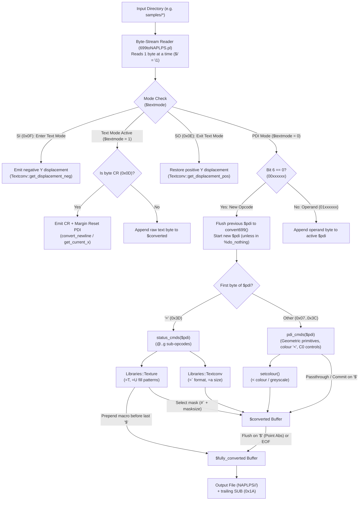

# Architecture: Telidon 699 to NAPLPS Converter

## 1. Overview

**Telidon699toNAPLPS** is a Perl-based binary protocol translator written by John Durno (2019) that converts early **Telidon 699** videotex graphics files (CRC Technical Note No. 699-E, *Picture Description Instructions (PDI) for the Telidon Videotex System*, 1979) into **Telidon 709 / NAPLPS** format (North American Presentation Level Protocol Syntax, ANSI X3.110-1983 / CSA T500-1983).

While Telidon 699 and NAPLPS share the same foundational 7-bit ASCII Picture Description Instruction (PDI) architecture and geometric drawing primitives (`POINT`, `LINE`, `ARC`, `RECTANGLE`, `POLYGON`), NAPLPS reorganized control and status opcodes:
- Telidon 699 multiplexed status commands (screen resets, coordinate domains, colour/greyscale modes, line styles, algorithmic fill patterns, wait timers, and text sizing/formatting) behind a single **`PDI Control – Status` (`=`, `0x3D`)** escape opcode followed by an ASCII sub-opcode (`@` through `g`).
- NAPLPS promoted `DOMAIN` (`!`), `TEXT` (`"`), `TEXTURE` (`#`), `WAIT` (`=`), `SELECT COLOUR` (`>`), `BLINK` (`?`), and `RESET` (`SPC` / `US`) into standalone opcodes, expanded colour specification (`<`), and replaced Telidon 699's algorithmic hatching parameters with predefined and macro-programmable texture masks.

This repository bridges those specification differences so historical Telidon 699 artwork can be rendered on NAPLPS-compliant decoders and emulators.

---

## 2. Repository Structure

```text
Telidon699toNAPLPS/
├── 699toNAPLPS.pl          # CLI entry point, byte-stream parser, state machine, and opcode dispatcher
├── Libraries/
│   ├── Textconv.pm         # Text size (=a), text format (=` ), and baseline displacement converter
│   ├── Texture.pm          # Fill pattern (=T, =U) to NAPLPS programmable texture mask synthesizer
│   └── texture1.pl~        # Early prototype script for 8x8 bit-packed grid generation
├── comparison.md           # Opcode-by-opcode reference table comparing Telidon 699 and NAPLPS (0x00–0x7F)
├── comparison.ods          # OpenDocument Spreadsheet version of the 699 vs. NAPLPS opcode table
├── samples/                # Corpus of 65+ Telidon 699 test graphics files (primitives, text, fills, RGB)
├── README.txt              # Basic usage instructions and known limitations
└── LICENSE                 # GNU General Public License v2.0
```

---

## 3. High-Level Data Flow



---

## 4. Core Components & Subsystems

### 4.1 Byte-Stream Parser & State Machine ([699toNAPLPS.pl](file:///home/pi/GitHub/TEIA_TELIDON_ETC/Telidon699toNAPLPS/699toNAPLPS.pl))

The main script iterates over all files in the target directory passed via `$ARGV[0]` (skipping files ending in `text`), creating a mirrored output directory under `NAPLPS/<indir>/` and writing diagnostic logs to `logfile.txt`.

#### Instruction Framing
Telidon 699 uses 7-bit ASCII framing where bit 6 distinguishes **opcodes** (`00xxxxxx`, `0x00`–`0x3F`) from **multi-byte operands/data** (`01xxxxxx`, `0x40`–`0x7F`):
1. The file handle reads one byte at a time (`$/ = \1`) and unpacks each byte into an 8-bit binary string (`unpack("B*", $_)`).
2. In **PDI Graphics Mode (`$textmode == 0`)**, any byte matching `/00\d\d\d\d\d\d/` triggers execution of the previously accumulated `$pdi` instruction via `convert699($pdi)`.
3. Unmapped C0 control characters and unused 699 opcodes (`NUL`, `SOH`–`ACK`, `DLE`–`CAN`, `SUB`–`US`, `SPC`, `!`, `"`, `#`, `>`, `?`) are listed in `%do_nothing` ([699toNAPLPS.pl](file:///home/pi/GitHub/TEIA_TELIDON_ETC/Telidon699toNAPLPS/699toNAPLPS.pl#L87-L122)) and ignored so they do not start a spurious `$pdi` accumulation.
4. Operand bytes (`01xxxxxx`) are concatenated onto `$pdi` until the next opcode, mode switch (`SI`), or `EOF`.

#### Two-Stage Output Buffering (`$fully_converted` vs. `$converted`)
The converter maintains two string buffers per file ([699toNAPLPS.pl](file:///home/pi/GitHub/TEIA_TELIDON_ETC/Telidon699toNAPLPS/699toNAPLPS.pl#L30-L33)):
- **`$converted`**: Accumulates translated NAPLPS commands starting from the most recent `POINT Set (Absolute Invisible)` (`$`, `0x24`).
- **`$fully_converted`**: Stores all output committed prior to the most recent `$` command.

Whenever a new `$` (`00100100`) opcode is processed in `pdi_cmds()` ([699toNAPLPS.pl](file:///home/pi/GitHub/TEIA_TELIDON_ETC/Telidon699toNAPLPS/699toNAPLPS.pl#L563-L566)), `$current_position` is updated, the existing `$converted` buffer is flushed to `$fully_converted`, and `$converted` is reset to hold the new `$` instruction. This two-stage buffer enables **retroactive macro injection**: when a custom fill texture (`=T` or `=U`) is encountered *after* a `$` positioning command, the NAPLPS texture definition macro (which moves the drawing cursor to `0,0` to draw the 16×16 texture bitmap) can be appended to `$fully_converted`—placing it *before* the `$` positioning command in the final byte stream so the drawing cursor position is not clobbered.

#### Session Initialization (`initialize_pdi`)
For the first processed file (and whenever `=B` Reset/Initialize is encountered), `initialize_pdi()` ([699toNAPLPS.pl](file:///home/pi/GitHub/TEIA_TELIDON_ETC/Telidon699toNAPLPS/699toNAPLPS.pl#L660-L688)) emits a 22-byte NAPLPS bootstrap sequence:
- `SO` (`0x0E`), `CAN` (`0x18` – end macro processing), `US @@` (`0x1F 0x40 0x40` – Non-Selective Reset),
- `SO` (`0x0E`), `=@` (wait 0), `SPC {O` (Selective Reset),
- `!H@@I` (`DOMAIN`: 1-byte single-value operands, 3-byte multi-value 2D coordinates, minimum logical pel size `@@I`),
- `SI` (`0x0F`), `SO` (`0x0E`), `#@@@` (reset line/fill texture).

---

### 4.2 Opcode & Status Command Translation ([699toNAPLPS.pl](file:///home/pi/GitHub/TEIA_TELIDON_ETC/Telidon699toNAPLPS/699toNAPLPS.pl))

#### Geometric Primitives & C0 Controls (`pdi_cmds`)
Handled in `pdi_cmds()` ([699toNAPLPS.pl](file:///home/pi/GitHub/TEIA_TELIDON_ETC/Telidon699toNAPLPS/699toNAPLPS.pl#L529-L628)):
- **Passthrough Primitives**: `POINT` (`$`, `%`, `&`, `'`), `LINE` (`(`, `)`, `*`, `+`), `ARC` (`,`, `-`, `.`, `/`), `RECTANGLE` (`0`, `1`, `2`, `3`), and `POLYGON` (`4`, `5`, `6`, `7`) share identical opcode and 9-bit (3-byte) coordinate operand encodings between Telidon 699 and NAPLPS and are copied verbatim.
- **Format Effectors & Shift Codes**: `BEL` (`0x07`), `BS` (`0x08`), `HT` (`0x09`), `LF` (`0x0A`), `VT` (`0x0B`), `FF` (`0x0C`), `CR` (`0x0D`), `SO` (`0x0E`), `SI` (`0x0F`), and `EM` (`0x19` – G2 accents) are passed through, with `SO` additionally restoring text baseline displacement when `$displacement_flag` is set.
- **Bit Formats (`8`, `9`, `:`, `;`)**: Telidon 699 run-length and point-by-point raster opcodes are detected and logged to stdout as unimplemented.

#### Status Sub-Commands (`status_cmds`)
In Telidon 699, `=` (`0x3D`) prefixes status commands where the second byte (`@` through `g`) selects the operation ([699toNAPLPS.pl](file:///home/pi/GitHub/TEIA_TELIDON_ETC/Telidon699toNAPLPS/699toNAPLPS.pl#L147-L494)):

| 699 Status Prefix | 699 Meaning | Converter Action / NAPLPS Output |
| :--- | :--- | :--- |
| `=@` | Clear screen to black | Emits Selective Reset `SPC x DEL` (`0x20 0x78 0x7F`) |
| `=A` | Clear screen to transparent | Logged to `logfile.txt` (unimplemented) |
| `=B` | Clear to black & initialize | Calls `initialize_pdi()` |
| `=C` | Clear screen to current colour | Emits Selective Reset `SPC h DEL` (`0x20 0x68 0x7F`) |
| `=D` .. `=G` | Coordinate domain (9, 12, 15, 18 bits) | Logged (`=D` 9-bit/3-byte is already the default) |
| `=H` | Blink off, transparency off | Emits `?@@@` (`0x3F 0x40 0x40 0x40`) |
| `=I` .. `=K` | Blink / transparency combinations | Logged to `logfile.txt` |
| `=L`, `=N` | Colour mode | Sets `$colourmode = 1`; re-runs `setcolour($current_colour)` |
| `=M`, `=O` | Greyscale mode | Sets `$colourmode = 0`; re-runs `setcolour($current_colour)` |
| `=P` .. `=S` | Line style (solid, dotted, dashed, dot-dash) | Emits `#@`, `#A`, `#B`, or `#C` |
| `=T`, `=U` | Fill pattern (no highlight / colour highlight) | Delegates to `Texture::texture()`; emits `#` texture command |
| `=V`, `=W` | Fill black highlight / reserved | Logged to `logfile.txt` |
| `=X` .. `=[` | Marker control | Logged to `logfile.txt` |
| `=\` .. `=_` | Wait commands (timed / indefinite) | Logged to `logfile.txt` |
| `` =` `` | Text format (rotation, spacing, break) | Delegates to `Textconv::textformat()`; emits `"` + format + size |
| `=a` | Text size (8 sizes + double-height bit) | Delegates to `Textconv::textsize()`; emits `"` + format + size |
| `=b` .. `=g` | Character set, tabs, reserved char defs | Logged to `logfile.txt` |

#### Colour & Greyscale Conversion (`setcolour`)
Telidon 699's `PDI Control – Value` (`<`, `0x3C`) specifies a 3-bit GRB colour or 3-bit greyscale intensity in bits 5..3 (`substr($binop699, 2, 3)`) of its first operand byte ([699toNAPLPS.pl](file:///home/pi/GitHub/TEIA_TELIDON_ETC/Telidon699toNAPLPS/699toNAPLPS.pl#L631-L657)):
- **Colour Mode (`$colourmode == 1`)**: Because NAPLPS interleaves `G R B G R B` bits across each 6-bit data byte (`01xxxxxx`), a 3-bit 699 primary colour (`G R B`) is converted to full-intensity NAPLPS RGB by repeating the 3-bit group twice per byte (`01` + `GRB` + `GRB`) across 3 operand bytes (`<` + 3 identical bytes).
- **Greyscale Mode (`$colourmode == 0`)**: In Telidon 699, a 3-bit value `(b1, b2, b3)` represents an 8-level greyscale intensity where `R = G = B = (b1, b2, b3)`. To encode equal `G`, `R`, and `B` channels in NAPLPS's interleaved `G R B G R B` bit layout across 3 bytes (9 bits per channel), each bit of the 3-bit intensity is tripled across the three bytes:
  - Byte 1: `01` + `b1 b1 b1` + `b2 b2 b2`
  - Byte 2: `01` + `b3 b3 b3` + `b1 b1 b1`
  - Byte 3: `01` + `b2 b2 b2` + `b3 b3 b3`

---

### 4.3 Text Conversion & Baseline Compensation ([Libraries/Textconv.pm](file:///home/pi/GitHub/TEIA_TELIDON_ETC/Telidon699toNAPLPS/Libraries/Textconv.pm))

`Textconv` translates Telidon 699's discrete text attributes (`=a` and `` =` ``) into NAPLPS's continuous coordinate-based `TEXT` (`"`, `0x22`) command and compensates for character cell origin differences:

1. **Character Size (`Textconv::textsize`, [Textconv.pm](file:///home/pi/GitHub/TEIA_TELIDON_ETC/Telidon699toNAPLPS/Libraries/Textconv.pm#L43-L77))**:
   - Unpacks the operand byte of `=a`: bit 5 (`substr($pdi_699, 2, 1)`) is the `$double_height` flag, and bits 2..0 (`substr($pdi_699, 5, 3)`) form a 3-bit size index (`0` = largest to `7` = smallest).
   - Maps the size index to a character-per-line denominator via `@xvalues = (26, 36, 54, 72, 96, 128, 180, 260)` ([Textconv.pm](file:///home/pi/GitHub/TEIA_TELIDON_ETC/Telidon699toNAPLPS/Libraries/Textconv.pm#L32)), computing normalized width $dx = \frac{1}{\text{xvalues}[\text{size}]}$ and height $dy = \frac{11}{8} \times dx$ (doubled if `$double_height` is set).
   - Encodes $(dx, dy)$ as a 3-byte (9-bit fixed-point binary fraction) NAPLPS coordinate operand via `dec2pdi()` and `dec2bin()`.

2. **Text Format (`Textconv::textformat`, [Textconv.pm](file:///home/pi/GitHub/TEIA_TELIDON_ETC/Telidon699toNAPLPS/Libraries/Textconv.pm#L80-L107))**:
   - Unpacks the operand byte of `` =` ``: extracts character path rotation (bits 3..2) and vertical line spacing (bits 1..0).
   - Maps 699's vertical spacing (`1, 1.5, 2, 2.5`) to NAPLPS's spacing (`1, 1.25, 1.5, 2`) via `%internarrow` and returns the 2-byte NAPLPS `TEXT` format operand.
   - Whenever either `` =` `` or `=a` is processed in `699toNAPLPS.pl`, both `$current_textformat` and `$current_textsize` are combined into a complete 6-byte NAPLPS `"<format><size>` instruction.

3. **Vertical Baseline Displacement (`get_displacement_neg` / `get_displacement_pos`, [Textconv.pm](file:///home/pi/GitHub/TEIA_TELIDON_ETC/Telidon699toNAPLPS/Libraries/Textconv.pm#L112-L167))**:
   - Telidon 699 and NAPLPS align the character box differently relative to the graphics cursor upon entering text mode (`SI`).
   - When `SI` (`0x0F`) transitions `$textmode` from `0` to `1`, `699toNAPLPS.pl` emits a `POINT Relative Invisible` (`%`) command generated by `get_displacement_neg()` using empirical per-size offset tables (`@disp` and `@disp_double`, [Textconv.pm](file:///home/pi/GitHub/TEIA_TELIDON_ETC/Telidon699toNAPLPS/Libraries/Textconv.pm#L33-L34)) to shift the baseline down.
   - When `SO` (`0x0E`) exits text mode, `get_displacement_pos()` emits the inverse `%` relative shift so subsequent graphics primitives resume from the expected coordinate.

4. **Carriage Return Left-Margin Alignment (`convert_newline` & `get_current_x`, [699toNAPLPS.pl](file:///home/pi/GitHub/TEIA_TELIDON_ETC/Telidon699toNAPLPS/699toNAPLPS.pl#L497-L527))**:
   - In Telidon 699, a `CR` (`0x0D`) in text mode returns the cursor to the X coordinate established by the most recent `POINT Set (Absolute Invisible)` (`$`).
   - `convert_newline()` extracts only the X bits from `$current_position` (`get_current_x()`, masking Y bits to `000`) and wraps a relative positioning sequence (`SO` + `%<x_coords>` + `SI`) immediately after `CR`.

---

### 4.4 Algorithmic Fill to Programmable Texture Synthesis ([Libraries/Texture.pm](file:///home/pi/GitHub/TEIA_TELIDON_ETC/Telidon699toNAPLPS/Libraries/Texture.pm))

In Telidon 699, `=T` (fill without outline highlight) and `=U` (fill with colour highlight) specify hatching patterns algorithmically using coordinate-like operands:
- The first bit of X (`$xAngle`) and Y (`$yAngle`) selects diagonal hatching (+45° / +135°) vs. orthogonal hatching (0° / 90°).
- The next 4 bits of X and Y specify fractional line densities (`$xDec`, `$yDec` in $\frac{1}{16}$ increments).

`Texture::texture($operands)` ([Texture.pm](file:///home/pi/GitHub/TEIA_TELIDON_ETC/Telidon699toNAPLPS/Libraries/Texture.pm#L27-L176)) converts these algorithmic parameters into NAPLPS `TEXTURE` (`#`, `0x23`) commands:
1. **Solid Fill Shortcut**: If either X or Y density bits are `1111`, or if both `$xFill < 2` and `$yFill < 2` with no angle flags, `texture()` returns `'@'` (NAPLPS solid fill `#@`).
2. **16×16 Bitmap Synthesis**:
   - Converts fractional densities into integer pixel strides (`$xFill = int(1 / $xDec)`, `$yFill = int(1 / $yDec)`).
   - Generates a 256-character (`16 × 16`) binary string (`'0'` / `'1'`) using one of three pattern generators:
     - `gridrect($xFill, $yFill)` ([Texture.pm](file:///home/pi/GitHub/TEIA_TELIDON_ETC/Telidon699toNAPLPS/Libraries/Texture.pm#L179-L209)): Horizontal (`$main::masksize = '@B@'`), vertical (`'@P@'`), or crosshatch grid (`'@R@'`).
     - `gridangleY($xFill)` ([Texture.pm](file:///home/pi/GitHub/TEIA_TELIDON_ETC/Telidon699toNAPLPS/Libraries/Texture.pm#L212-L241)): +135° diagonal lines (`'@R@'`).
     - `gridangleX($yFill)` ([Texture.pm](file:///home/pi/GitHub/TEIA_TELIDON_ETC/Telidon699toNAPLPS/Libraries/Texture.pm#L245-L281)): -45° diagonal lines (`'@R@'`).
3. **NAPLPS Macro & Incremental Point Packing (`def_texture_begin` / `def_texture_end`)**:
   - Each 16-bit row of the 16×16 grid is right-padded with two `'0'` bits to 18 bits and packed into three 6-bit NAPLPS data bytes (`01xxxxxx`), yielding $16 \times 3 = 48$ bitmap bytes.
   - `def_texture_begin($pelsize)` ([Texture.pm](file:///home/pi/GitHub/TEIA_TELIDON_ETC/Telidon699toNAPLPS/Libraries/Texture.pm#L283-L311)) prefixes the bitmap with `@R@!I<pelsize>` + `ESC D A` (define macro `A` as texture mask) + `8$` + `9A` (Incremental Point opcode `9` with operand `A`).
   - `def_texture_end()` ([Texture.pm](file:///home/pi/GitHub/TEIA_TELIDON_ETC/Telidon699toNAPLPS/Libraries/Texture.pm#L313-L330)) appends `ESC E` (end macro definition) + `SO` + `!H@@I#@` (restore default coordinate domain and solid texture).
4. **Texture Slot Registration ([699toNAPLPS.pl](file:///home/pi/GitHub/TEIA_TELIDON_ETC/Telidon699toNAPLPS/699toNAPLPS.pl#L280-L329))**:
   - NAPLPS supports four programmable texture masks (`` ` ``, `h`, `p`, `x`), tracked in `%textures`. Due to decoder compatibility issues noted in comments, `@textures` is pinned to slot `` ` `` (`0x60`).
   - When a new custom fill pattern is synthesized, `#` + `` ` `` + `$texture` is appended to `$fully_converted` (before the last `$` absolute point), and `#` + `` ` `` + `$masksize` is appended to `$converted` to activate the mask.

---

## 5. Known Limitations & Design Trade-offs

As documented in [README.txt](file:///home/pi/GitHub/TEIA_TELIDON_ETC/Telidon699toNAPLPS/README.txt) and inline code comments:
- **Unimplemented 699 Opcodes**: Bit-format raster images (`8`, `9`, `:`, `;`), higher-precision coordinate domains (`=E` 12-bit, `=F` 15-bit, `=G` 18-bit), blink/transparency modes (`=A`, `=I`, `=J`, `=K`), black highlight fills (`=V`), markers (`=X`–`=[`), timed/indefinite waits (`=\`–`=_`), and alternate character sets/tabs (`=b`–`=g`) are logged to `logfile.txt` rather than translated.
- **Texture Mask Slot Recycling & Bi-Directional Diagonals**: Only programmable texture mask `` ` `` is actively used (`@textures = ('`')`), and simultaneous X+Y diagonal cross-hatching (`$xAngle && $yAngle`) is only partially handled when `$xFill == 2 && $yFill == 2` ([Texture.pm](file:///home/pi/GitHub/TEIA_TELIDON_ETC/Telidon699toNAPLPS/Libraries/Texture.pm#L131-L139)).
- **Heuristic Font Scaling**: Because Telidon 699 specifies 8 fixed character sizes whereas NAPLPS specifies continuous character field dimensions, `@xvalues`, `@disp`, and `@disp_double` in [Textconv.pm](file:///home/pi/GitHub/TEIA_TELIDON_ETC/Telidon699toNAPLPS/Libraries/Textconv.pm#L32-L36) use empirically tuned constants to approximate 699 text layout and baseline alignment.
